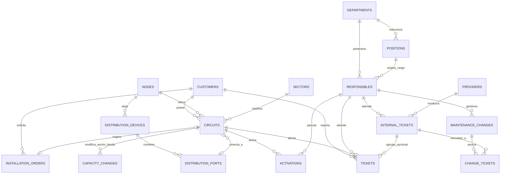
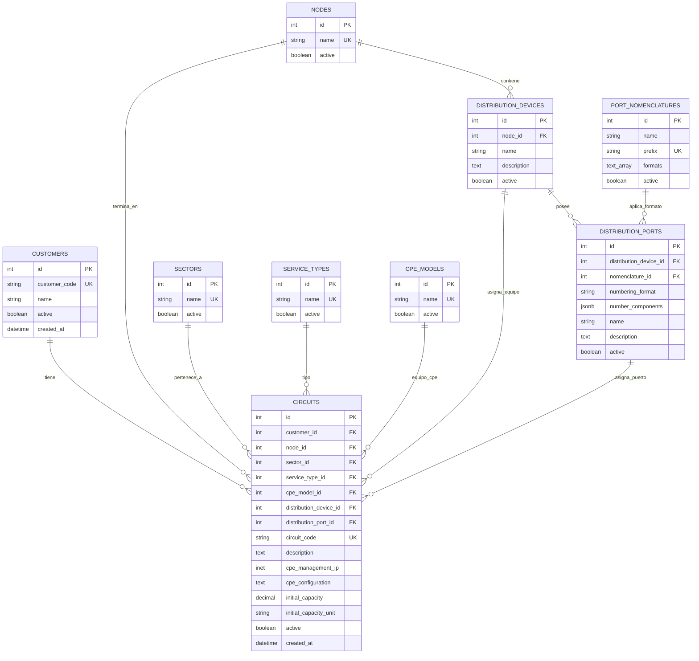
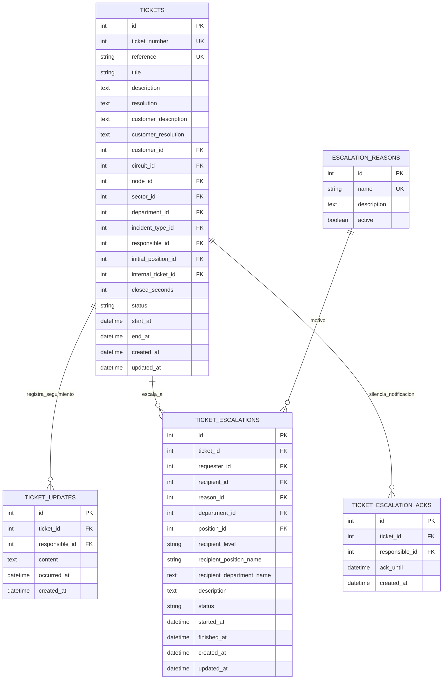
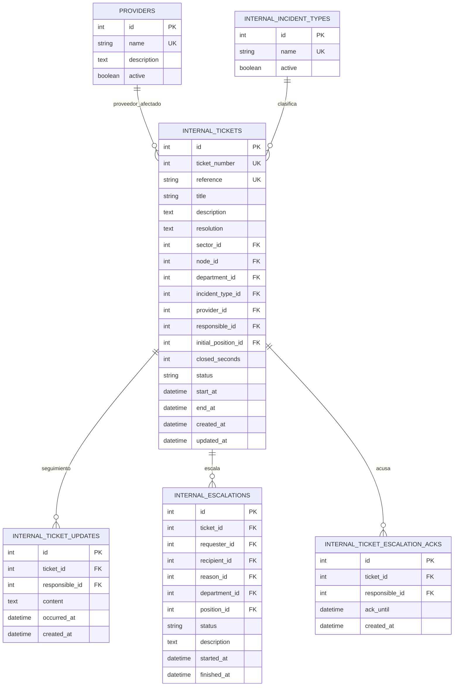
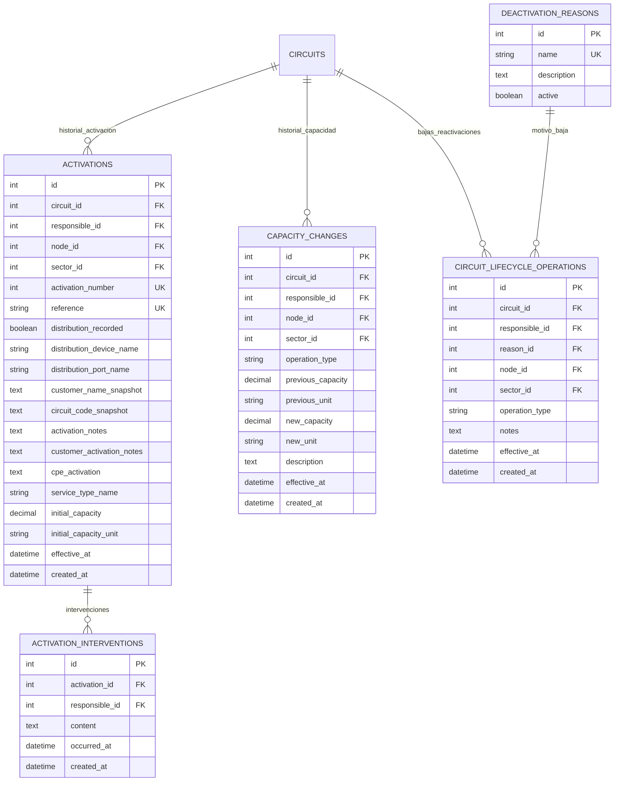
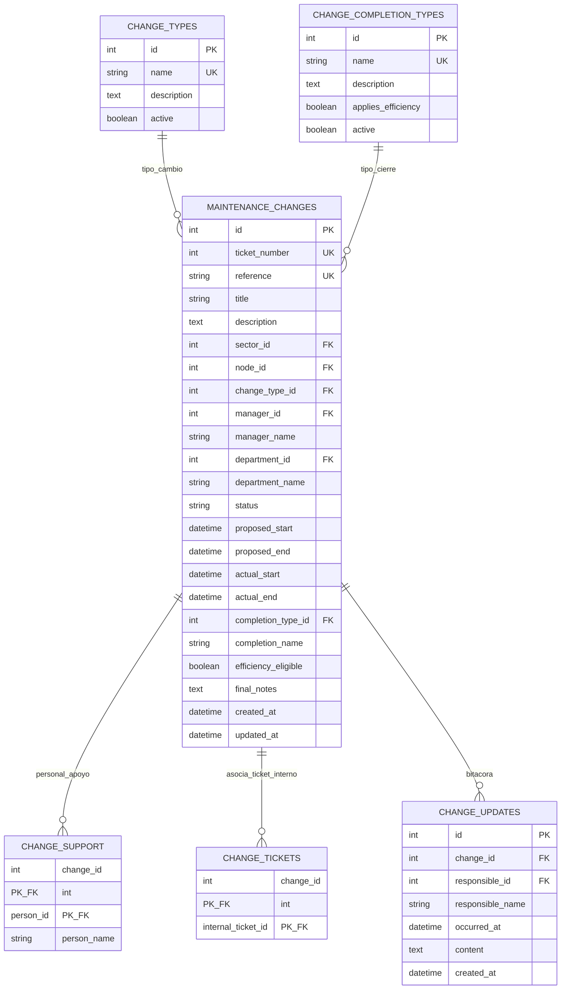
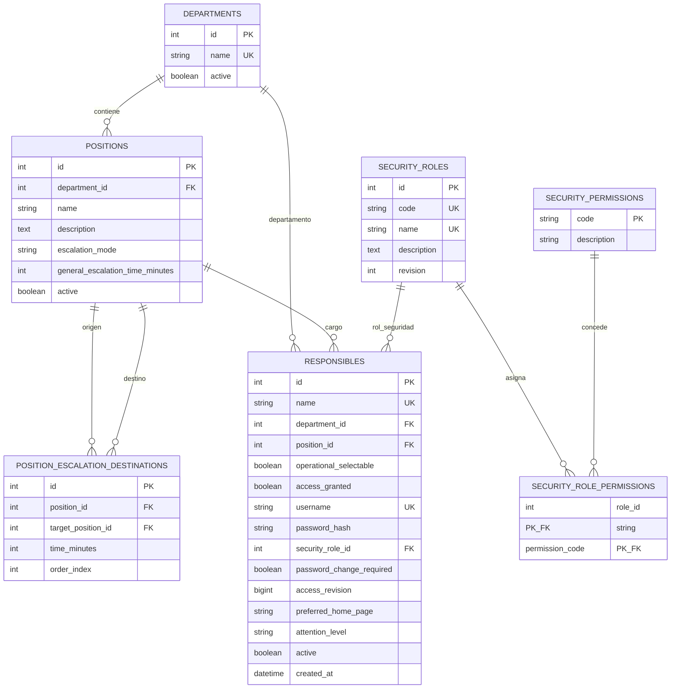

# Diagrama Entidad-Relación — Ticketyn (v0.8.0+)

Este documento presenta la arquitectura de datos relacional de **Ticketyn**, organizada según los principios de modelado de dominio limpio y los dominios funcionales del sistema.

---

## 1. Principios Arquitectónicos del Modelo de Datos

1. **Identidad Única de Personas y Cuentas:**
   - La tabla `responsibles` representa la identidad única de toda persona en Ticketyn (operadores, ingenieros NOC, administradores). No existe una tabla `users` paralela.
   - Las tres dimensiones de estado en `responsibles`:
     - `active`: Estado operativo (si es falso, invalida sesiones inmediatamente).
     - `access_granted`: Autorización administrativa persistente para ingresar al sistema.
     - `operational_selectable`: Disponibilidad para figurar en selectores operativos de tickets y circuitos.
2. **Topología de Red e Infraestructura de Distribución:**
   - Separación estricta entre la **infraestructura viva** (`circuits`, `distribution_devices`, `distribution_ports`) y las **instantáneas históricas inmutables** en FMS (`activations`).
   - Las claves compuestas (`node_id`, `distribution_device_id`, `distribution_port_id`) garantizan coherencia física: un puerto pertenece a un equipo y el equipo a un nodo.
3. **Desacoplamiento Operativo:**
   - Los **Tickets de Clientes** (`tickets`) dependen de clientes y circuitos.
   - Los **Tickets Internos** (`internal_tickets`) representan fallas de infraestructura troncal/proveedor y carecen de cliente o circuito.
   - Las **Operaciones FMS** registran el ciclo de vida del circuito con datos técnicos inmutables.
   - El **Control de Cambios** planifica ventanas de mantenimiento con equipo de soporte múltiple y asociación a tickets internos.

---

## 2. Diagrama ER Maestro (Núcleo del Sistema)

El siguiente diagrama ilustra el núcleo de entidades operativas y sus relaciones cardinales principales:



---

## 3. Diagramas ER por Dominio Funcional

### A. Clientes, Circuitos y Topología de Distribución

Representa la planta externa, clientes y puertos de distribución:



---

### B. Tickets de Clientes y Escalamientos NOC

Flujo de incidentes de clientes con bitácoras, escalamientos por puestos y acuses (ACK):



---

### C. Tickets Internos (Infraestructura y Proveedores)

Incidentes que afectan la red troncal sin impactar directamente a un solo circuito/cliente:



---

### D. Gestión Operativa FMS (Ciclo de Vida de Circuitos)

Operaciones técnicas con instantáneas históricas preservadas:



---

### E. Control de Cambios (Ventanas de Mantenimiento)

Planificación de ventanas NOC, asignación de soporte técnico múltiple y vinculación con tickets internos:



---

### F. Estructura Organizacional, Cuentas y Seguridad RBAC

Modelado de la jerarquía NOC y control de acceso:



---

### G. Órdenes de Instalación y Solicitudes Administrativas

Antecedentes documentales y requerimientos recibidos:

```mermaid
erDiagram
    INSTALLATION_ORDERS {
        int id PK
        string reference UK
        string external_reference
        int customer_id FK
        string service
        string location
        string contact
        string phone
        datetime requested_at
        text notes
        int created_by FK
        int circuit_id FK_UK
        datetime created_at
        datetime updated_at
    }

    INSTALLATION_REQUESTS {
        int id PK
        string mailbox
        string folder
        bigint uidvalidity
        bigint uid
        string checksum
        string sender
        string subject
        text body
        datetime received_at
        string state
        int reviewer_id FK
        int order_id FK_UK
        text discard_reason
        datetime created_at
        datetime updated_at
    }

    ADMIN_REQUEST_TYPES {
        int id PK
        string name UK
        text description
        boolean active
    }

    ADMIN_REQUESTS {
        int id PK
        string reference UK
        int request_type_id FK
        int responsible_id FK
        int customer_id FK
        int circuit_id FK
        string requester_name
        string requester_channel
        datetime requested_at
        text description
        datetime created_at
        datetime updated_at
    }

    ADMIN_REQUEST_LINKS {
        int id PK
        int admin_request_id FK
        int ticket_id FK
        int internal_ticket_id FK
        int change_id FK
        datetime created_at
    }

    CUSTOMERS ||--o{ INSTALLATION_ORDERS : "cliente"
    CIRCUITS |o--o| INSTALLATION_ORDERS : "circuito_creado"
    INSTALLATION_ORDERS |o--o| INSTALLATION_REQUESTS : "procesada_desde"
    ADMIN_REQUEST_TYPES ||--o{ ADMIN_REQUESTS : "tipo"
    CUSTOMERS ||--o{ ADMIN_REQUESTS : "cliente_opcional"
    CIRCUITS ||--o{ ADMIN_REQUESTS : "circuito_opcional"
    ADMIN_REQUESTS ||--o{ ADMIN_REQUEST_LINKS : "vincula_operaciones"
```

---

## 4. Invariantes de Integridad y Reglas Críticas del Esquema

1. **Restricción de Jerarquía de Distribución:**
   - Un circuito no puede tener `distribution_device_id` sin tener `node_id`.
   - Un circuito no puede tener `distribution_port_id` sin tener `distribution_device_id`.
   - Las claves foráneas compuestas garantizan que el puerto pertenece al equipo especificado y el equipo al nodo especificado.
2. **Instantáneas Históricas vs Estado Vivo en FMS:**
   - En `activations`, si `distribution_recorded = true`, se capturan `distribution_device_name` y `distribution_port_name` como texto inmutable. Modificaciones futuras en la tabla `circuits` no alteran los registros históricos.
   - En activaciones previas a v0.8.0, `distribution_recorded = false` indica que la infraestructura histórica no fue registrada (se presenta como «No registrado»).
3. **Escalamientos:**
   - Escalar un ticket (`tickets` o `internal_tickets`) crea un registro en `ticket_escalations` o `internal_escalations`.
   - **Regla sagrada de Ticketyn:** El escalamiento **nunca** modifica el `responsible_id` del ticket original.
4. **Protección del Superadministrador:**
   - Está prohibido desactivar, degradar de rol o retirar facultades al último Superadministrador activo mediante comprobación en `lock_security(session)`.
